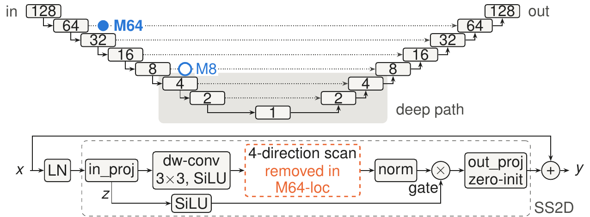
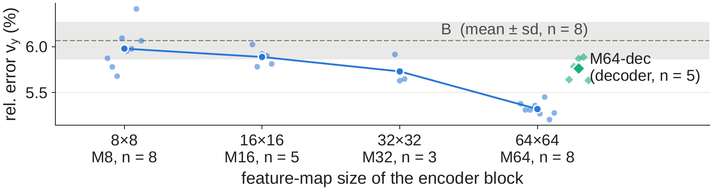
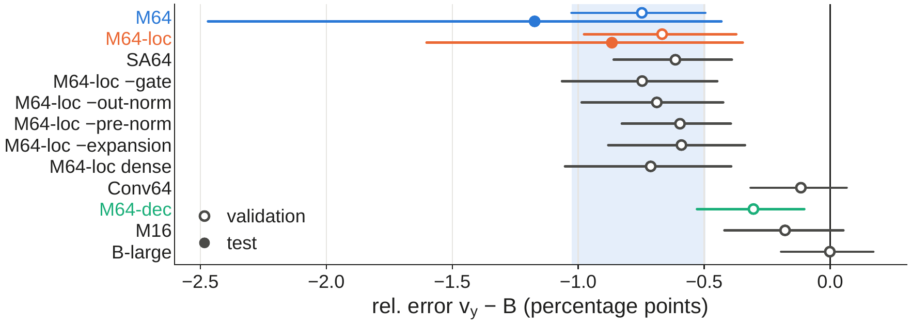

# Airfoil Flow Prediction: *Where* and *Why* Mamba Blocks Enhance U-Net Architectures

Course project, Deep Machine Learning (Chalmers University of Technology, 2026), Group 62:
Cristiano Corona, Francesca Marina Pozzi.

A U-Net (DfpNet, [Thuerey et al. 2020](https://arxiv.org/abs/1810.08217)) predicts the RANS flow around an airfoil
(pressure p and velocity vx, vy on a 128 x 128 grid) in one forward pass. Convolutions are local, but pressure obeys
a Poisson equation and depends on the whole domain. We insert a **Mamba (selective state space) block** at
different resolutions of the U-Net and ask where it helps, and why.

**Main result.** A single block at the **64 x 64** level lowers the error on the airfoil-induced velocity v_y on unseen
airfoils. The gain does not need the state space scan: the final architecture, **U-Net + M64-loc** (the
Mamba-style block without its scan), adds 7 k parameters, trains 1.6x slower than the baseline and lowers the
v_y error by 13 % on the test set (pre-registered, confirmed).

**Report:** [`docs/report/report.pdf`](docs/report/report.pdf) gives the full treatment of the project and the results.
**Poster:** [`docs/poster/poster.pdf`](docs/poster/poster.pdf).



*Top: the DfpNet U-Net and the insertion points. Bottom: the residual Mamba (SS2D) block. Its output projection is
zero-initialised, so at the start the network is the baseline. M64-loc removes the 4-direction scan.*

## Results

All errors are relative L1 errors (in %) on the normalised fields, averaged over samples and seeds. Test = 90
samples on 30 airfoils never seen in training, opened only for pre-registered comparisons. Intervals are 95 %
two-level bootstrap intervals (airfoil profiles x training seeds) of the paired difference to the baseline B.

| Finding | Comparison (test set unless noted) | Result |
|---|---|---|
| 1. Deep levels: Mamba adds nothing, but can replace them | M8 (block at 8 x 8) - B, overall error, 8 seeds | -0.01 points [-0.34, +0.26]: no gain |
| | Deep path (below 8 x 8) removed (TR) / replaced by 11 Mamba blocks at 8 x 8 (DRv11), 5 seeds | B 2.90 %, TR 3.47 %, DRv11 2.79 %; DRv11 - TR -0.69 points [-1.10, -0.26] |
| 2. At 64 x 64: lower v_y error | M64 - B, v_y error, 8 seeds | 6.64 % -> 5.47 %, -1.17 points [-2.47, -0.43] (-18 %), **confirmed** |
| | M64 - B, p / vx / overall error | no demonstrated difference |
| 3. The gain does not need the SSM | M64-loc - B, v_y error, 8 seeds | 6.64 % -> 5.78 %, -0.87 points [-1.60, -0.35] (-13 %), **confirmed** |
| | SA64 (self-attention), Conv64 (plain conv block), validation | SA64 matches the gain at 17x the training time; Conv64: no proven gain |
| | Full 53.8 k data set, validation, 3 seeds | M64-loc keeps a smaller v_y gain (-0.22 points, -4.7 %) |
| 4. Why v_y and not p | wall band (within 4 px of the airfoil) | v_y error -11 % (M64), -10 % (M64-loc) |

Our reading (consistent with the data, not tested directly): the U-Net already solves the global, elliptic part of
the problem (it works like a multigrid V-cycle); what it lacks is processing at **high resolution**, near the wall,
where v_y is almost entirely induced by the airfoil.

<p align="center">
  
  
</p>

## Repository layout

```
mdf/              the library: models and blocks (start here), data, analysis helpers
  models.py         model factory: baseline and every variant, where the block is inserted
  blocks.py         the blocks: SS2D Mamba (two versions), self-attention, CBAM
  ablation.py       ablations of the 64 x 64 block, including M64-loc (the final architecture)
  deep_replace.py   deep path removed (TR) or replaced by Mamba blocks (DRv11)
  data.py           data loading, normalisation, fixed train / validation splits
  explore.py        per-sample and per-region errors, paired two-level bootstrap
scripts/          train, evaluate, run queues, analyses, figures (index: scripts/README.md)
queues/           the run lists of every experiment (index: queues/README.md)
splits/           committed validation file lists (profile-disjoint split)
tests/            pytest suite (model equivalences, weight fingerprints, splits, statistics)
docs/             report, poster, lab notebook, pre-registrations, setup log, results (CSV / Markdown), figures
environment/      conda + pip specification of the environment
train/, data/     the original Deep-Flow-Prediction code (unmodified reference baseline, data generation)
```

The original README of Deep-Flow-Prediction is in [`docs/upstream-README.md`](docs/upstream-README.md).

### Names used in the report, the poster and the code

| Report | Poster | `--variant` (`--level`) | Description |
|---|---|---|---|
| B | B | `B` | original DfpNet (2.33 M parameters) |
| B-large | B-large | `B-large` | DfpNet with 33 base channels (capacity control, no block) |
| M<sup>sh</sup><sub>8</sub> | - | `MD` (`8`) | first Mamba version: one 1-D Mamba layer shared by the 4 scan directions |
| M<sub>8</sub> ... M<sub>64</sub> | M8 ... M64 | `MDv` (`8` ... `64`) | one SS2D Mamba block (VMamba version) in the encoder |
| M<sup>dec</sup><sub>64</sub> | M64-dec | `MDv-dec` | the same block in the decoder at 64 x 64 |
| **M<sup>loc</sup><sub>64</sub>** | **M64-loc** | **`MDv-local` (`64`)** | **M64 without the scan: the final architecture** |
| SA<sub>64</sub> | SA64 | `SA` (`64`) | self-attention block at 64 x 64 |
| Conv<sub>64</sub> | Conv64 | `Conv` (`64`) | plain residual convolutional block at 64 x 64 |
| TR / DR-M | Truncated / DRv11 | `TR` / `DRv11` | deep path removed / replaced by 11 Mamba blocks at 8 x 8 |

## Setup

Tested on Linux (Fedora) with an NVIDIA RTX 4060 Laptop GPU (8 GB), Python 3.12, PyTorch 2.10 (CUDA 12.8),
mamba-ssm 2.3.2.post1, causal-conv1d 1.7.0. Full record with versions and checksums: [`docs/setup-log.md`](docs/setup-log.md).

```bash
conda env create -f environment/conda-from-history.yml        # env "mdf": Python 3.12 from conda-forge
conda activate mdf
mkdir -p ~/.cache/pip-tmp && export TMPDIR=~/.cache/pip-tmp   # torch wheel is ~900 MB; /tmp may be too small
pip install -r environment/pip-freeze.txt                     # torch 2.10+cu128 and the prebuilt mamba-ssm wheels
```

mamba-ssm and causal-conv1d are installed from their prebuilt wheels (GitHub releases, pinned in
`environment/pip-freeze.txt`); building them from source needs a matching nvcc / GCC pair and is not required.

**Data.** The 6.4 k data set of Deep-Flow-Prediction (1.3 GB), unpacked outside the repository and linked into `data/`:

```bash
mkdir -p ~/data/dfp && cd ~/data/dfp
curl -L -o data_6k.tar.gz 'https://dataserv.ub.tum.de/s/m1470791/download?path=%2F&files=data_6k.tar.gz'
tar xzf data_6k.tar.gz
cd <repository>
ln -s ~/data/dfp/data/train data/train      # 6400 .npz files
ln -s ~/data/dfp/data/test  data/test       # 90 .npz files
```

**Check.**

```bash
python scripts/check_env.py --seed 0      # CUDA + Mamba kernels actually used; prints OK
python -m pytest tests/ -q                # needs the data and a GPU; 6 tests are skipped by design
```

## Using the final architecture

```python
import torch
from mdf.models import build_from_cfg

net = build_from_cfg({"variant": "MDv-local", "level": 64})   # U-Net + M64-loc, weights initialised
x = torch.randn(1, 3, 128, 128)                                 # free-stream vx, vy, airfoil mask
y = net(x)                                                      # p, vx, vy (normalised), (1, 3, 128, 128)
```

`level=64` must be given explicitly (the default level is 8). M64-loc never calls the selective scan, so this model
also runs on the CPU and without mamba-ssm installed. The block itself is `mdf.ablation.SS2DVMambaLocal` and works
on any (B, C, H, W) feature map, so it can be added to another U-Net in the same way (after the first encoder
layer, residual, with a zero-initialised output projection; see `mdf/models.py`).

Train it with the same protocol as in the report (133 epochs, batch 10, lr 6e-4 with the original decay, fixed
profile-disjoint validation split), then evaluate on validation:

```bash
python scripts/train.py --seed 0 --epochs 133 --variant MDv-local --level 64 --out-dir ~/runs/m64loc_s0
python scripts/evaluate.py --run-dir ~/runs/m64loc_s0 --split val
```

One run (training + validation evaluation) takes about 19 minutes on an RTX 4060 (B: about 12.5 minutes).

## Reproducing the results

**Protocol.** Every run uses an explicit `--seed` (weight initialisation and batch order) and the same seeds across
models, so that comparisons are paired; the train / validation split is fixed (`splits/val_grouped_seed0.txt`,
whole airfoils held out). Every run records its configuration, git commit and environment in `config.json`.
Exploration used only the validation set. Each test comparison was pre-registered (`docs/preregistration-*.md`,
lab notebook) before the test set was opened, once.

**The final comparison (B vs M64-loc, 8 seeds; about 4.2 h on an RTX 4060):**

```bash
python scripts/run_queue.py queues/reproduce-final.txt --out-root ~/runs/reproduce --cutoff YYYY-MM-DDTHH:MM
python scripts/final_analysis.py --split val --seeds 0-7 \
    --config "B=$HOME/runs/reproduce/B_s*" --config "MDv64-local=$HOME/runs/reproduce/MDv64-local_s*" \
    --out-dir ~/runs/reproduce/analysis --fig-dir ~/runs/reproduce/analysis
```

`run_queue.py` trains and evaluates each run, skips finished runs (so it can be restarted) and starts a run only if
it ends before `--cutoff`. `final_analysis.py` writes per-configuration means, paired differences with bootstrap
intervals and region errors to `summary.md`; the original validation result is in
`docs/results/val-final-mdv64local` (M64-loc - B on v_y: -0.67 points [-0.98, -0.37]). The test set is evaluated
with `evaluate.py --split test` and `final_analysis.py --split test --allow-test`. Results can vary slightly
between GPUs and library versions (cuDNN is not deterministic by default).

**The other findings.** [`queues/README.md`](queues/README.md) maps every experiment to its queue file, the seeds
and the folder of `docs/results/` with its numbers; the scripts are described in [`scripts/README.md`](scripts/README.md).
The full-data-set experiment ran on a cloud VM: see [`docs/cloud-guide.md`](docs/cloud-guide.md).

## Documentation

- [`docs/report/report.pdf`](docs/report/report.pdf): the report (LaTeX source `main.tex`; Fig. 2 from
  `make_fig_results.py`).
- [`docs/poster/poster.pdf`](docs/poster/poster.pdf): the poster (source `poster.tex`).
- `docs/results/`, `docs/figures/`: all numbers and figures, as written by the scripts.

### Process record

Not needed to use or reproduce the code, but kept as evidence of how the results were obtained (the report's
"pre-registered" and "executed once" claims can be checked here):

- [`docs/lab-notebook.md`](docs/lab-notebook.md): chronological record of every decision, experiment and result,
  including negative results and corrections.
- [`docs/preregistration-*.md`](docs/): pre-registrations of the later experiments and test passes (the earlier
  ones are entries of the notebook), each committed before the runs or the test pass it fixes.
- [`docs/setup-log.md`](docs/setup-log.md): environment and data set installation, with checksums.
- The one-off scripts used while running the experiments (night launchers, single test sessions, exploratory
  analyses) are not in the repository any more; the notebook refers to them by path, and they are at the git tag
  `experiments-final`. The submitted version is the tag `v1.1-submission`.

## Credits and license

Based on [Deep-Flow-Prediction](https://github.com/thunil/Deep-Flow-Prediction) by N. Thuerey, K. Weissenow,
L. Prantl and X. Hu (Apache-2.0; [`LICENSE`](LICENSE)). The original training code (`train/`) and data generation
(`data/`) are kept unmodified. If you use the baseline, please cite:

```
@article{thuerey2020deepFlowPred,
  title={Deep learning methods for Reynolds-averaged Navier--Stokes simulations of airfoil flows},
  author={Thuerey, Nils and Wei{\ss}enow, Konstantin and Prantl, Lukas and Hu, Xiangyu},
  journal={AIAA Journal}, year={2020}, volume={58}, number={1}, pages={25--36}
}
```

The Mamba blocks use [mamba-ssm](https://github.com/state-spaces/mamba) (Gu and Dao, Apache-2.0);
`mdf/mamba_ref.py` adapts its reference selective scan. `SS2DVMamba` re-implements the SS2D module of
[VMamba](https://github.com/MzeroMiko/VMamba) (Liu et al. 2024, MIT).

**AI assistance.** The code, the analyses and the documentation of this repository were developed with the help of
an AI coding assistant (Claude Code), under the direction and review of the authors. The research questions, the
experimental design, the decisions recorded in the lab notebook and the conclusions are the authors'.
